# Dots and Circles

## Architecture

### Server

A flask server with at least one endpoint:
GET /ocr
Requires:
- an attached image
Returns:
- an array of bounding boxes
- the text that was found

### Bounding Box Generator

Draws bounding boxes around all words on a page (but *not* around anything
else) and labels the boxes with the script the word is written in.

Requirements:
- Draws boxes around each word
- Does not draw boxes around non-word elements
- Does not overlap bounding boxes
- Labels word script correctly

Manchu-script words are passed on the the Lexigraph OCR.

### Lexigraph OCR

Given a lexigraph (an image of a word, i.e. the contents of a bounding box)
returns the Unicode characters representing the word. Composed of one or more
transformers, using CTC for loss calculation.

#### Training Data

A set of Manchu words was pulled from
[kaikki](https://kaikki.org/dictionary/Manchu/index.html). See below:

Tatu Ylonen: Wiktextract: Wiktionary as Machine-Readable Structured Data, Proceedings of the 13th Conference on Language Resources and Evaluation (LREC), pp. 1317-1325, Marseille, 20-25 June 2022.

## Roadmap

- [x] **Under the hood**:
  - [x] **nn module**: provides the basis for the implementation of ANNs
  - [x] **loss module**: calculates loss and gradients
  - [x] **optim module**: updates parameters based on gradients
- [x] **Basic OCR**:
  - [x] **Simple synthetic training data generation**: black text on white background
  - [x] **Transformer OCR Model**: reads image line by line, outputs CTC string
  - [x] **CTC loss function**: generates loss values for TrOCR output
  - [x] **Simple training loop**: train TrOCR on synthetic data, graph results

# Progress

I didn't start using Claude code until after the `nn` module was fully implemented, since I wanted to work through it myself.

There's no automatic differentiation. This means that backpropogation must be manually implemented for each Module, and has resulted in some errors. For example, I forgot to account for shortcut layers around the attention and MLP blocks of the Transformer, so the gradients were off. Claude caught that in a later pass.

Another problem downstream of this is that, to make things marginally easier, I averaged out loss and gradients when doing backprop.
Tests still showed decreasing loss, so I figured it was fine.
However, when trying to train the actual OCR model, accuracy stalled out quickly, so I had to undo it.
Accuracy here is measured as the percentage of the first n output characters which are correct, where n is the length of the actual word.
Compare before and after this change:

| Before                                                              | After                                                               |
| ------------------------------------------------------------------- | ------------------------------------------------------------------- |
| 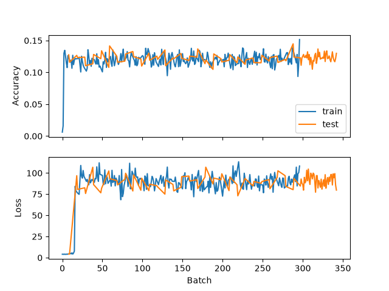 | 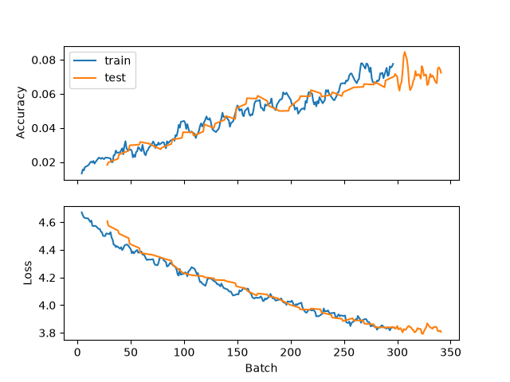 |

Since I hadn't yet implemented CTC loss calculation and was just using Cross-Entropy Loss, the misalignment between input tokens (rows of pixels) and output (characters) was causing issues. Because there was a causal attention mask in the multi-head attention module, the OCR model was attempting to output characters corresponding to parts of the image it hadn't yet seen. Postponing the inevitable CTC implementation, I added an option to disable the mask, which marginally improved accuracy.

| Before                                                              | After                                                               |
| ------------------------------------------------------------------- | ------------------------------------------------------------------- |
|  | 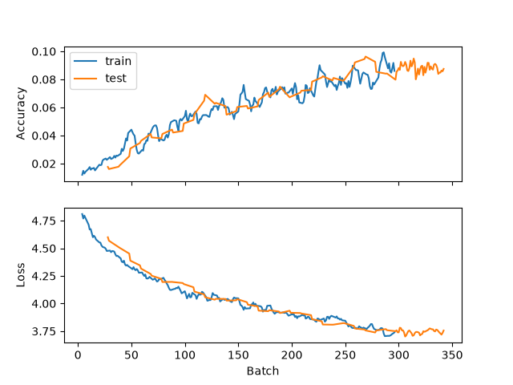 |

I then tried updating the learn rate throughout training, starting with a high value, 0.1, which drops over time so that it's about 0.0027 by the end of the first epoch.

| Before                                                              | After                                                               |
| ------------------------------------------------------------------- | ------------------------------------------------------------------- |
|  | 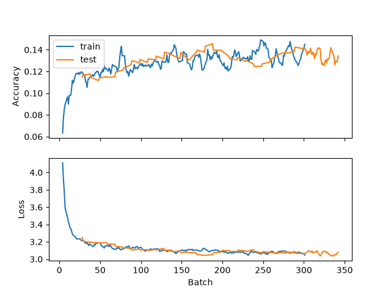 |

Next, tokens were changed from being one row of pixels to four, which are then compressed by a factor of four by being run through a linear layer.

| Before                                                              | After                                                               |
| ------------------------------------------------------------------- | ------------------------------------------------------------------- |
|  | 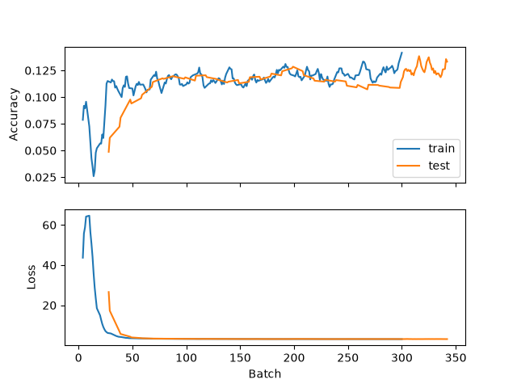 |

Positional encoding (non-learned, sinosoidal) was added.
The model was then split into an A and B variant: A stayed the same, and B got readout tokens.
Model B initially learned faster, but plateaued with an accuracy around .2, and Model A quickly caught up and plateaued at the same point.
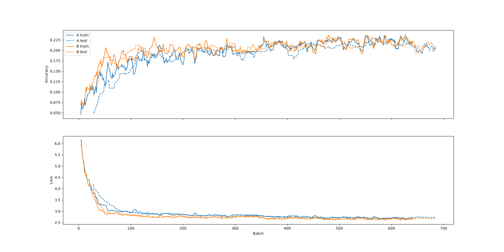

CTC loss was implemented, and a CTC model (Model C) was compared against Model B (readout tokens).
Accuracy here is measured as `1 - edit_distance(guess, word) / len(word)`.
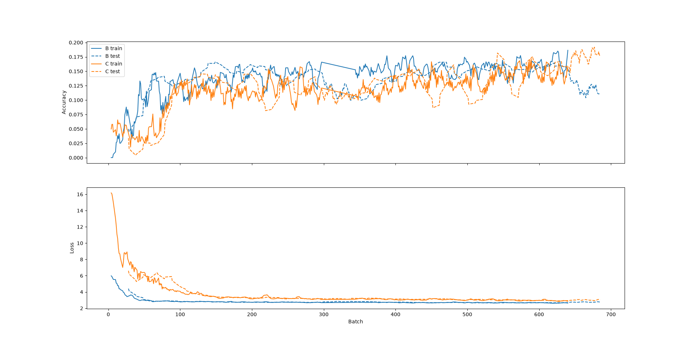

Accuracy seemed to be increasing slightly at the end of the 2-epoch run comparing B and C, so I trained a 4-transformer and 8-transformer variant of C for 5 epochs.
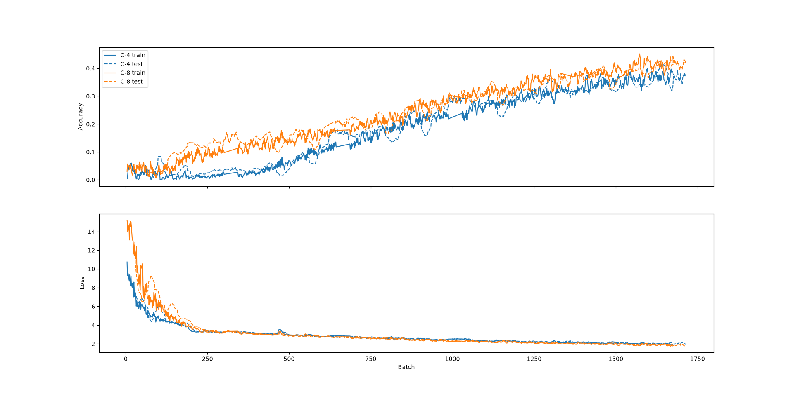

Then followed with a 10-epoch run with 4- and 8-transformer variants of Models B and C.
Model C clearly has better accuracy, with the 4-transformer Model C beating the 8-transformer Model B.
There's also a large gap between C-8 and C4.
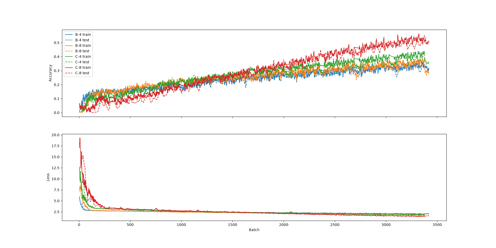
For comparison, I ran a C-16 version as well:
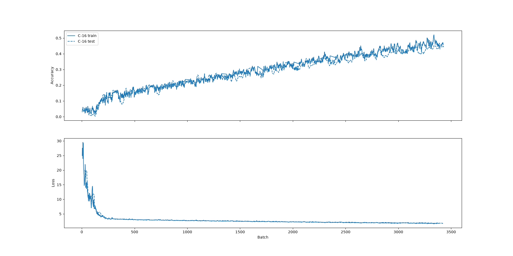

Model C has a linear layer that compresses the 128 pixel tokens (4 rows of 32px each) down to the transformer's embedding dimension of 32.
Rather than simply increase the number of transformers, I then did a comparison of variants with a larger embedding dimension.
Four variants of Model C were trained for 5 epochs:
- C-8/32: 8 transformers, embedding dimension 32
- C-16/32: 16 transformers, embedding dimension 32
- C-8/64: 8 transformers, embedding dimension 64
- C-8/128: 8 transformers, embedding dimension 128
Those with a larger embedding dimension clearly outperformed those with a smaller one, but the accuracy difference between 64 and 128 was negligable,
and C-8/128 was by far the slowest to train.
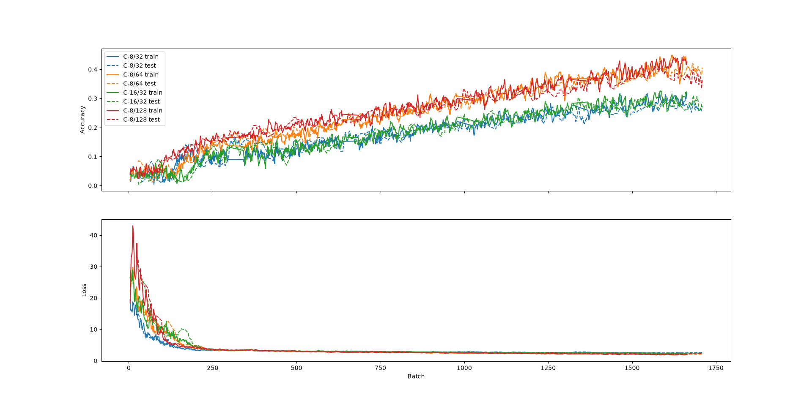

The test accuracy seemed to be falling below the train accuracy for C-8/64 and C-8/128 in the previous test, so a fourth model, Model D, was added,
which had dropout enabled. A 20-epoch run comparing Model C and Model D showed that Model D avoided overfitting, with test accuracy still rising
at the end of the run. Model C's test accuracy stopped rising shortly after epoch 10.
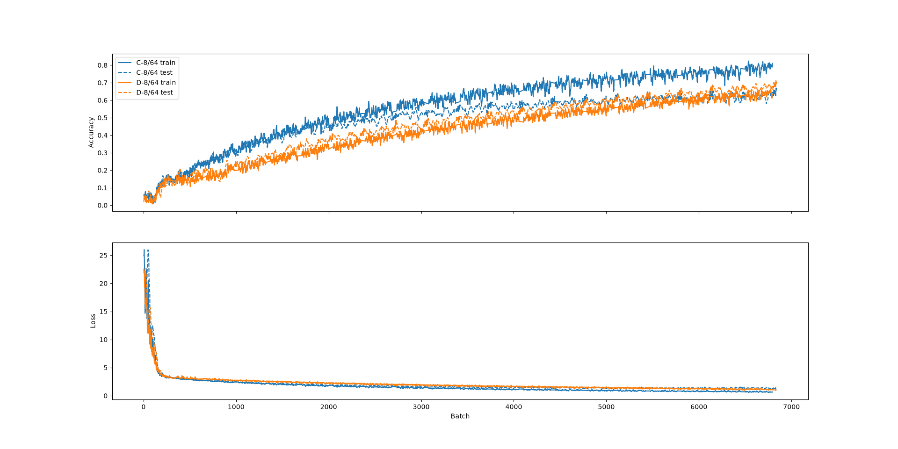

Though results were promising, the lengthy training time was quite inconvenient. I implemented Adam (the previous runs had used SGD) and compared
Models C and D again in a 5-epoch run. By the end of 5 epochs, test accuracy for both models was around 0.6, while in the previous (SGD) run,
accuracy was about 0.4 for Model C and 0.3 for Model D at epoch 5.
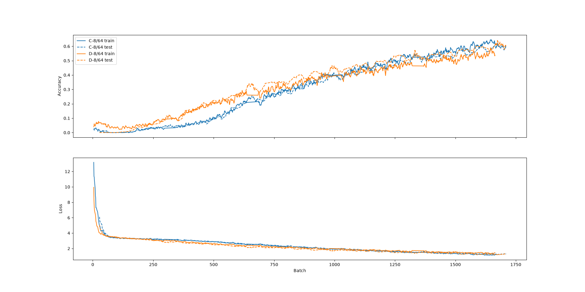

Next was a comparison of the efficacy of various learning rates for Adam (and one for SGD as a reference), for both Model C and Model D.
This was a 3-epoch run, and both models seemed about equivalent, which makes sense, since they didn't diverge until around epoch 10 in earlier runs.
Adam with learning rates of 1e-3 and 3e-3 performed better than SGD and Adam with learning rate of 3e-4. 1e-3 and 3e-3 seemed about equivalent.
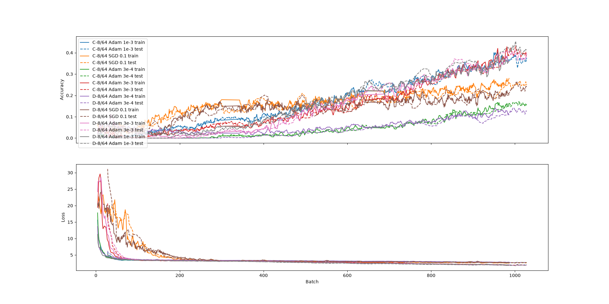

Learning rates of 1e-3 and 3e-3 were chosen for a 30-epoch run. Models trained with 3e-3 had better accuracy than 1e-3 at the end of the run,
and Model D slightly outperformed Model C with a learning rate of 3e-3. Model D massively outperformed Model C with a rate of 1e-3.
The difference between Model D and C appears to be overfitting: both variants of Model C had lower accuracy on test data than training data,
though in the 3e-3 variant the difference was small.
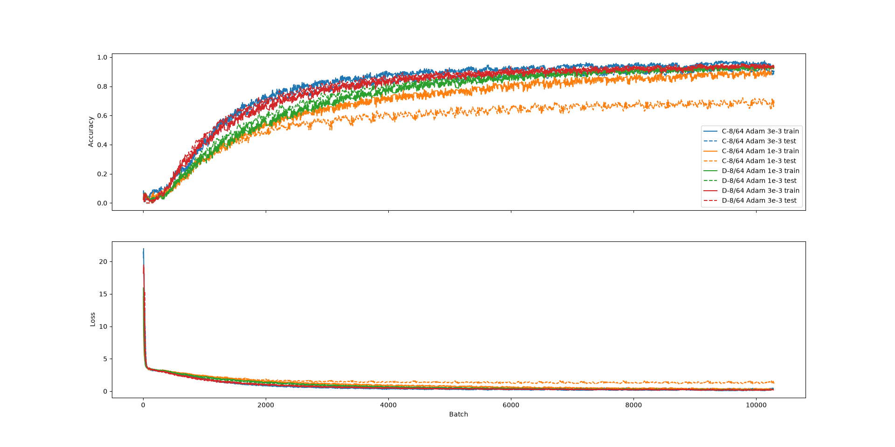

A look into the word-level accuracy (that is, what percentage of words were guessed entirely correctly) for D-8/64(lr=3e-3) showed that
the model predicted 78.9% of words correctly. Of the misses, 16% are off only by free variation selectors (FVS). In the Mongolian Unicode block,
of which Manchu is a subset, there are four characters which are invisible, and serve only to modify the preceding character.
- U+180B MONGOLIAN FREE VARIATION SELECTOR ONE (FSV1)
- U+180C MONGOLIAN FREE VARIATION SELECTOR TWO (FSV2)
- U+180D MONGOLIAN FREE VARIATION SELECTOR THREE (FSV3)
- U+180E MONGOLIAN VOWEL SEPARATOR (MVS)
- U+180F MONGOLIAN FREE VARIATION SELECTOR FOUR (FSV4)
The training data, assembled from the Kaikki dictionary, contains some words with FVS1 and FVS2.
Sometimes the presence of an FVS makes a meaningful difference to the appearance of the word, but not always:

| Font     | FVS  | With FVS                                                               | Without                                                                |
| -------- | ---- | ---------------------------------------------------------------------- | ---------------------------------------------------------------------- |
| ShuKai   | FVS1 | 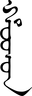 | 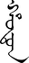 |
| ZhengHei | FVS2 | 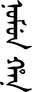 | 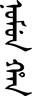 |
| GuFeng | FVS1 |  | 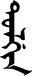 |
| YaBai  | FVS1 |  | 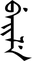 |

A bigger factor in accuracy is word length: the percentage of guesses which are completely correct drops as the number of characters in the label increases.
Partially this inevitable, as the more characters there are in a label, the more chances there are to make an error, and even one error means that the whole
word is marked as wrong. However, the model also consistently performs worse on characters which are lower in the image.
For comparison, 2000 short words (<=24 tokens, i.e. <=96px tall) were tested with various degrees of padding at the top.
The more padding was added, the worse the model's performance.

| Shift (tokens) | 0     | 4     | 8     | 16    | 24    | 32    | 40   |
| -------------- | ----- | ----- | ----- | ----- | ----- | ----- | ---- |
| Exact	         | 86.8% | 59.7% | 45.1% | 31.1% | 21.7% | 10.0% | 3.8% |

This indicates that a single-word accuracy could likely be improved by adding random amounts of padding (within the limits of context length) to lexigraphs
during training, so that the model has more exposure to tokens later in the sequence.
As it stands, accuracy is highest on words with labels 1-4 characters long (about 90%), and as length increases, it begins dropping steadily to 79% at length 9.
Past that, it drops more rapidly, with labels of length 13 having 30% accuracy, and 16 or more characters having 4%.

To account for this, training data was modified by adding random amounts of padding to words where it would fit. This new run (labelled as Run 24) was compared
to the one just described labelled as (Run 22). Like Run 22, Run 24 was 30 epochs long, but the comparison indicates that the model was still learning by the
end of epoch 30, and overall had worse accuracy. Notably, it did significantly worse on lexigraphs with no padding.
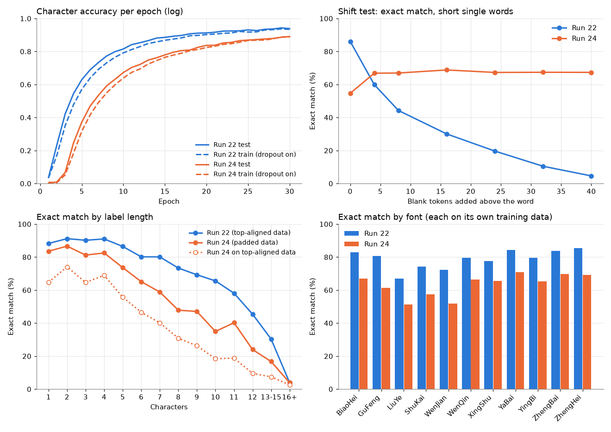

For the next run (Run 25), two changes were made. First: one third of training data was guaranteed to have no padding (e.g. the lexigraphs were top-aligned).
This was to deal with the fact that Run 24 showed lower accuracy on words with no padding. Second: train for 45 epochs. This is because Run 24 showed that
by the end of 30 epochs, the model was still learning. Run 25 showed overall performance similar to Run 24, but with improved performance on padded words
and on words with labels 11 characters or longer. Accuracy was still rising when the run ended, so training for longer would likely yield better accuracy.

Now that the models were getting fairly good results, I wanted to compare against real data. I used a
[dataset published by Sun Haipeng, Tao Wenhao, and Bi Xiaojun](https://www.scidb.cn/en/detail?dataSetId=b45491b63d694534a9323acf14846586).

Citation:
Haipeng SUN, Wenhao TAO, Xiaojun BI. A dataset of Manchu ancient book words for OCR[J]. China Scientific Data, 2026, 11(1): 1-11. DOI: 10.11922/11-6035.csd.2025.0069.zh. 

Images were cropped so that the edges of the word touched the edge of the image, then scaled up (or down) to a width of 32px, and the background
was whitened. Run 25's model had a character accuracy of 65.9%, with 16.4% whole-word accuracy. I wasn't expecting great performance, since the training
data all clean images of printed black text on a plain white background. Real-word data has several issues:
- paper (especially from the Early Modern period) isn't perfectly white and smooth
- many Manchu texts are hand-written and non-uniform
- Early Modern printing isn't perfect, even if it's better than handwriting
- old texts may have become damaged over time
For comparison, here are some real-world images (left) and the model's guess (right):

Next steps are to amend the synthetic data to more closely resemble the real-world data.
- Add paper textures to the background
- Add blur, noise, and other filters
- Add varying levels of text opacity
- Add varying text colors
- Add varying stroke thickness
